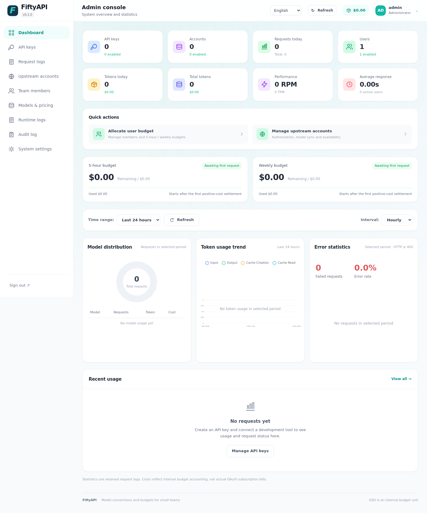

<div align="center">

# FiftyAPI

**A self-hosted AI gateway for small teams.**<br>
Share Claude Code, OpenAI Codex and Antigravity accounts with per-user dollar budgets.

[](https://github.com/dyunwei/fiftyapi/actions/workflows/ci.yml)
[](https://github.com/dyunwei/fiftyapi/releases)
[](https://hub.docker.com/r/dyunwei/fiftyapi)
[](go.mod)
[](LICENSE)

English | [简体中文](README.zh-CN.md)



</div>

## Why FiftyAPI

- **Simple to run** – one Go binary with an embedded Vue 3 UI and SQLite. No Redis, no extra services.
- **Built for teams of dozens** – "Fifty" describes the target size, not a hard user limit.
- **Your keys, not upstream tokens** – members use their own `sk-…` API keys; upstream credentials stay encrypted on the server.

## Features

| Feature | Description |
| --- | --- |
| 🔑&nbsp;**Upstream&nbsp;accounts** | Claude Code, OpenAI Codex and Antigravity OAuth with token refresh and model sync |
| 📦&nbsp;**sub2api&nbsp;migration** | Import users, original API keys and supported upstream accounts, with preview and safe retries |
| 🔌&nbsp;**API&nbsp;gateways** | Connect Sub2Api, New API, another FiftyAPI or compatible upstreams, with model aliases |
| 🧭&nbsp;**Native&nbsp;protocols** | Chat Completions, Messages, Responses (HTTP / SSE / WebSocket) |
| 💰&nbsp;**Dollar&nbsp;budgets** | Per-user 5-hour and 7-day windows shared across all keys and providers |
| ⚖️&nbsp;**Scheduling** | Priority, weights, concurrency limits, health checks, cooldown and safe retries |
| 📊&nbsp;**Logs&nbsp;&&nbsp;settlement** | Personal request logs, model pricing, automatic settlement and audit trail |
| 👥&nbsp;**Members** | Admin setup on first visit, self-registration, email invitations, account contribution links |
| 🌐&nbsp;**UI** | English / 简体中文, mobile friendly |
| 💾&nbsp;**Backups** | Local backups plus S3 / Cloudflare R2 |

## Quick Start

```sh
docker run -d \
  --name fiftyapi \
  --restart unless-stopped \
  --stop-timeout 60 \
  -p 28080:8080 \
  -v fiftyapi-data:/data \
  dyunwei/fiftyapi
```

1. Open http://localhost:28080 (or `http://SERVER_IP:28080`).
2. Get the setup token and enter it on the setup page to create the administrator:
   ```sh
   docker exec fiftyapi cat /data/setup-token
   ```
3. Add upstream accounts → verify and sync models → confirm prices → allocate member budgets → members create API keys.

> [!IMPORTANT]
> The master key is generated automatically and stored in the `fiftyapi-data` volume. Keep the volume and back up `/data/master.key` separately – database backups do not include it, and encrypted credentials cannot be recovered without it.

Compose, HTTPS, upgrades and restore: see the [deployment guide](docs/en/deployment.md).

## Migrate from sub2api

Choose **Migrate from sub2api Docker** during administrator setup. The web wizard guides export, upload, review and import of **users, original API keys and supported upstream accounts**, without requiring a separate guide. On the source Docker host, run:

```sh
curl -fsSL https://raw.githubusercontent.com/dyunwei/fiftyapi/main/scripts/migrate-sub2api.sh | sudo bash
```

No manual database password or host Python/psql installation is needed. The wizard also offers a direct script download. Members retain their email, password and keys; verify models, configure prices and switch the service URL before use. Migration is available only during initial setup; completing or skipping the wizard closes the import capability.

Imported users, invited members and the initial administrator receive **$100** budgets in each of the 5-hour and 7-day windows; self-registration starts at **$0**. Existing budgets are unchanged. Balances, plans and history are excluded. The wizard preselects conversion to FiftyAPI access and budget rules; uncheck it to keep restricted keys disabled. Source-disabled or expired keys remain disabled. See the [migration guide](docs/en/sub2api-migration.md).

## Connect a client

**Claude Code**

```sh
export ANTHROPIC_BASE_URL=http://localhost:28080
export ANTHROPIC_AUTH_TOKEN=YOUR_FIFTYAPI_KEY
claude
```

**Codex** and other clients: see [client configuration](docs/en/clients.md).

## Build from source

Requires Go (version in [go.mod](go.mod)). Frontend assets are prebuilt, so Node is only needed for UI development (Node 24+).

```sh
go build -buildvcs=false -o bin/fiftyapi ./cmd/fiftyapi
./scripts/start-local.sh      # setup token: .local/setup-token
```

The local startup script loads `.env` from the repository root as shell assignments
and exports its values (overriding matching shell environment variables). Set
`FIFTYAPI_LISTEN=127.0.0.1:28080` there to change the local listening address.

```sh
make test       # Go race, vet, frontend unit tests, source checks
make build      # frontend build + Go binary
make test-ui    # Playwright browser tests
```

Tests use temporary databases and simulated upstreams; they never call real providers.

## Status

FiftyAPI is in **public preview**. Antigravity and OpenAI have been verified with real accounts; Claude OAuth is verified only against simulated upstreams so far. Image/audio generation, payments and multi-instance deployment are out of scope. Details: [compatibility](docs/en/compatibility.md).

## Documentation

[Docs index](docs/en/README.md) · [Deployment](docs/en/deployment.md) · [Clients](docs/en/clients.md) · [Administration](docs/en/administration.md) · [Compatibility](docs/en/compatibility.md) · [Changelog](CHANGELOG.md)

## Contributing

Issues and pull requests are welcome – see [CONTRIBUTING.md](CONTRIBUTING.md). Report vulnerabilities privately as described in [SECURITY.md](SECURITY.md).

## License & credits

Licensed under [LGPL-3.0](LICENSE) (see also [COPYING.GPL-3](COPYING.GPL-3)). Account protocols and parts of the Antigravity adapter are adapted from [sub2api](https://github.com/Wei-Shaw/sub2api); see [THIRD_PARTY_NOTICES.md](THIRD_PARTY_NOTICES.md) and [source fingerprints](docs/sub2api-source.json).
