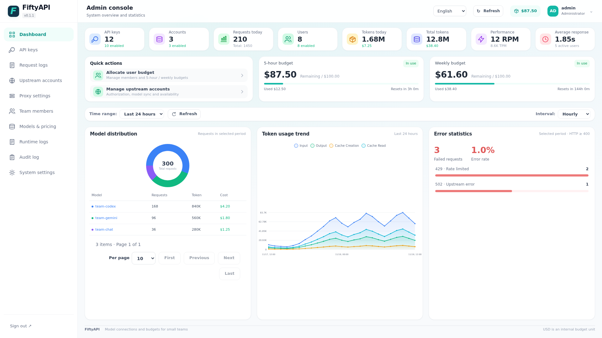

<div align="center">

# FiftyAPI

**A self-hosted AI gateway for small teams.**<br>
Share Claude Code, OpenAI Codex and Antigravity accounts with per-user dollar budgets.

[](https://github.com/dyunwei/fiftyapi/actions/workflows/ci.yml)
[](https://github.com/dyunwei/fiftyapi/releases)

English | [简体中文](README.zh-CN.md)



</div>

One Go binary bundles the console and SQLite. Members use individual API keys to share upstream accounts under per-user 5-hour and 7-day budgets. You can also connect compatible API gateways.

## Quick Start

```sh
mkdir -p data
docker run -d \
  --name fiftyapi \
  --restart unless-stopped \
  --stop-timeout 60 \
  -p 28080:8080 \
  -e TZ=Asia/Shanghai \
  -v "$(pwd)/data:/data" \
  dyunwei/fiftyapi
```

1. Open http://localhost:28080 (or `http://SERVER_IP:28080`).
2. Get the setup token and enter it on the setup page to create the administrator:
   ```sh
   docker exec fiftyapi cat /data/setup-token
   ```
3. Add upstream accounts → verify and sync models → confirm prices → allocate member budgets → members create API keys.

> [!IMPORTANT]
> The master key is generated automatically and stored in the host `./data` directory. Keep this directory and back up `/data/master.key` separately – database backups do not include it, and encrypted credentials cannot be recovered without it.

Compose, HTTPS, upgrades and restore: see the [deployment guide](docs/en/deployment.md).

## Next steps

- [Connect a client](docs/en/clients.md) and choose the protocol for Claude Code, Codex, or Cherry Studio.
- [Migrate from sub2api](docs/en/sub2api-migration.md) during initial setup to import users, original API keys, and supported upstream accounts.
- [Browse the docs](docs/en/README.md) for administration, compatibility, and development.

## Status

FiftyAPI is in **public preview**. Antigravity and OpenAI have been verified with real accounts; Claude OAuth is verified only against simulated upstreams so far. Image/audio generation, payments and multi-instance deployment are out of scope. Details: [compatibility](docs/en/compatibility.md).

## License & credits

Licensed under [LGPL-3.0](LICENSE) (see also [COPYING.GPL-3](COPYING.GPL-3)). Account protocols and parts of the Antigravity adapter are adapted from [sub2api](https://github.com/Wei-Shaw/sub2api); see [THIRD_PARTY_NOTICES.md](THIRD_PARTY_NOTICES.md) and [source fingerprints](docs/sub2api-source.json).
