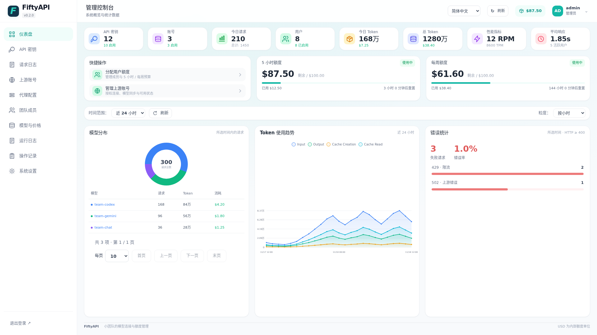

<div align="center">

# FiftyAPI

**面向小团队的自托管 AI 网关**<br>
共享 Claude Code、OpenAI Codex、Antigravity 账号，按人分配美元额度。

[](https://github.com/dyunwei/fiftyapi/actions/workflows/ci.yml)
[](https://github.com/dyunwei/fiftyapi/releases)

[English](README.md) | 简体中文



</div>

一个 Go 程序内嵌管理界面和 SQLite，无需 Redis。成员使用自己的 API Key，共享上游账号，并按 5 小时和 7 天窗口管理个人预算。也可以接入兼容的 API 网关。

## 快速开始

```sh
mkdir -p data
docker run -d \
  --name fiftyapi \
  --restart unless-stopped \
  --stop-timeout 60 \
  -p 28080:8080 \
  -e TZ=Asia/Shanghai \
  -v "$(pwd)/data:/data" \
  dyunwei/fiftyapi
```

1. 打开 http://localhost:28080（其他机器访问用 `http://服务器IP:28080`）。
2. 读取初始化口令，填入页面创建管理员：
   ```sh
   docker exec fiftyapi cat /data/setup-token
   ```
3. 添加上游账号 → 验证并同步模型 → 核对价格 → 给成员分配额度 → 成员创建 API Key。

> [!IMPORTANT]
> 主密钥自动生成并保存在宿主机 `./data` 目录中。请保留该目录，并单独备份 `/data/master.key`：数据库备份不包含主密钥，丢失后已加密的凭据无法恢复。

Compose、HTTPS、升级与恢复见 [部署说明](docs/deployment.md)。

## 下一步

- [接入客户端](docs/clients.md)，为 Claude Code、Codex 或 Cherry Studio 选择对应协议。
- [从 sub2api 迁移](docs/sub2api-migration.md)，在首次初始化时导入用户、原 API Key 和受支持的上游账号。
- [浏览文档](docs/README.md)，查找管理员操作、兼容性和开发说明。

## 项目状态

目前为**公开预览版**。Antigravity 和 OpenAI 已用真实账号验证；Claude OAuth 目前只有模拟验证。不支持图片/音频生成、支付和多实例部署。详见 [兼容性](docs/compatibility.md)。

## 许可证与致谢

采用 [LGPL-3.0](LICENSE)（另见 [COPYING.GPL-3](COPYING.GPL-3)）。账号协议和部分 Antigravity 转换代码改编自 [sub2api](https://github.com/Wei-Shaw/sub2api)，详见 [第三方声明](THIRD_PARTY_NOTICES.md) 和 [源码指纹](docs/sub2api-source.json)。
