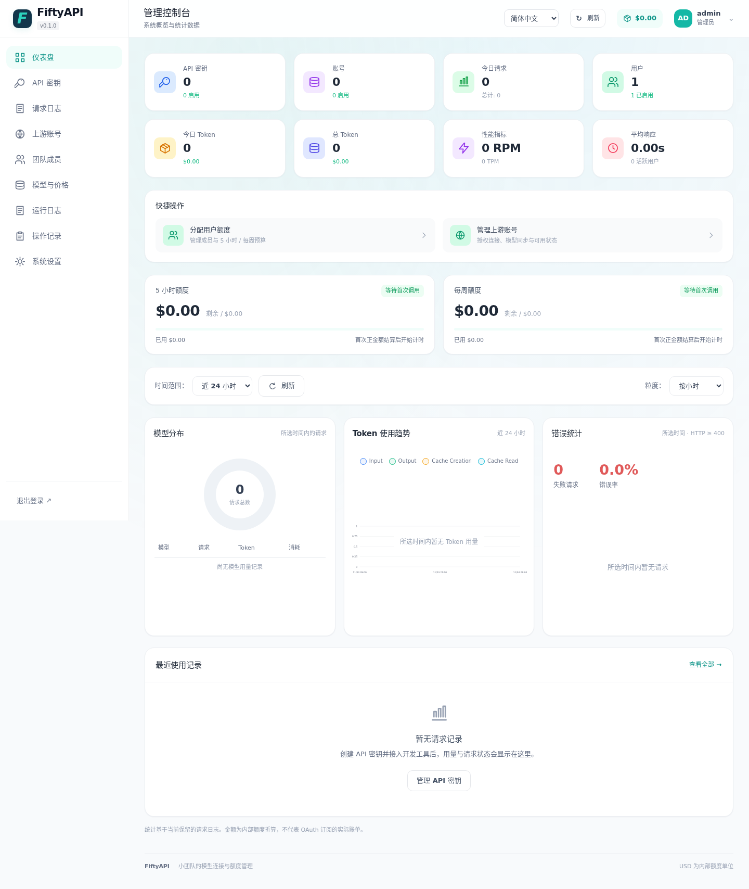

<div align="center">

# FiftyAPI

**面向小团队的自托管 AI 网关**<br>
共享 Claude Code、OpenAI Codex、Antigravity 账号，按人分配美元额度。

[](https://github.com/dyunwei/fiftyapi/actions/workflows/ci.yml)
[](https://github.com/dyunwei/fiftyapi/releases)
[](https://hub.docker.com/r/dyunwei/fiftyapi)
[](go.mod)
[](LICENSE)

[English](README.md) | 简体中文



</div>

## 为什么选择 FiftyAPI

- **部署简单**：一个 Go 程序，内嵌 Vue 3 页面和 SQLite，无需 Redis 或其他服务。
- **为几十人的团队设计**：Fifty 表示定位，不是 50 人的硬性限制。
- **成员不接触上游凭据**：成员使用自己的 `fifty_…` API Key，上游授权加密保存在服务端。

## 功能

| 功能 | 说明 |
| --- | --- |
| 🔑&nbsp;**上游账号** | Claude Code、OpenAI Codex、Antigravity OAuth 授权、令牌刷新、模型目录同步 |
| 🔌&nbsp;**API&nbsp;网关** | 接入 Sub2Api、New API、其他 FiftyAPI 及兼容上游，支持模型别名 |
| 🧭&nbsp;**原生协议** | Chat Completions、Messages、Responses（HTTP / SSE / WebSocket） |
| 💰&nbsp;**美元额度** | 每人 5 小时与 7 天窗口，所有 Key 和供应商共享 |
| ⚖️&nbsp;**调度** | 优先级、权重、并发上限、健康检查、冷却与安全重试 |
| 📊&nbsp;**日志与结算** | 个人请求日志、模型定价、自动结算与操作审计 |
| 👥&nbsp;**成员** | 首次访问设置管理员、自助注册、邮件邀请、账号贡献链接 |
| 🌐&nbsp;**界面** | 简体中文 / English，适配手机 |
| 💾&nbsp;**备份** | 本地备份及 S3 / Cloudflare R2 |

## 快速开始

```sh
docker run -d \
  --name fiftyapi \
  --restart unless-stopped \
  --stop-timeout 60 \
  -p 28080:8080 \
  -v fiftyapi-data:/data \
  dyunwei/fiftyapi
```

1. 打开 http://localhost:28080（其他机器访问用 `http://服务器IP:28080`）。
2. 读取初始化口令，填入页面创建管理员：
   ```sh
   docker exec fiftyapi cat /data/setup-token
   ```
3. 添加上游账号 → 验证并同步模型 → 核对价格 → 给成员分配额度 → 成员创建 API Key。

> [!IMPORTANT]
> 主密钥自动生成并保存在 `fiftyapi-data` 数据卷中。请保留数据卷，并单独备份 `/data/master.key`：数据库备份不包含主密钥，丢失后已加密的凭据无法恢复。

Compose、HTTPS、升级与恢复见 [部署说明](docs/deployment.md)。

## 客户端接入

**Claude Code**

```sh
export ANTHROPIC_BASE_URL=http://localhost:28080
export ANTHROPIC_AUTH_TOKEN=你的_FIFTYAPI_KEY
claude
```

**Codex** 及其他客户端见 [客户端接入](docs/clients.md)。

## 从源码构建

需要 Go（版本见 [go.mod](go.mod)）。仓库已包含前端产物，只有修改前端时才需要 Node 24+。

```sh
go build -buildvcs=false -o bin/fiftyapi ./cmd/fiftyapi
./scripts/start-local.sh      # 初始化口令：.local/setup-token
```

```sh
make test       # Go race、vet、前端单元测试、源码检查
make build      # 前端构建 + Go 程序
make test-ui    # Playwright 浏览器测试
```

测试使用临时数据库和模拟上游，不会调用真实供应商。

## 项目状态

目前为**公开预览版**。Antigravity 和 OpenAI 已用真实账号验证；Claude OAuth 目前只有模拟验证。不支持图片/音频生成、支付和多实例部署。详见 [兼容性](docs/compatibility.md)。

## 文档

[文档索引](docs/README.md) · [部署](docs/deployment.md) · [客户端](docs/clients.md) · [网关接入](docs/gateway-upstreams.md) · [兼容性](docs/compatibility.md) · [更新日志](CHANGELOG.md)

## 参与贡献

欢迎提交 Issue 和 PR，见 [CONTRIBUTING.md](CONTRIBUTING.md)。安全漏洞请按 [SECURITY.md](SECURITY.md) 私下报告。

## 许可证与致谢

采用 [LGPL-3.0](LICENSE)（另见 [COPYING.GPL-3](COPYING.GPL-3)）。账号协议和部分 Antigravity 转换代码改编自 [sub2api](https://github.com/Wei-Shaw/sub2api)，详见 [第三方声明](THIRD_PARTY_NOTICES.md) 和 [源码指纹](docs/sub2api-source.json)。
