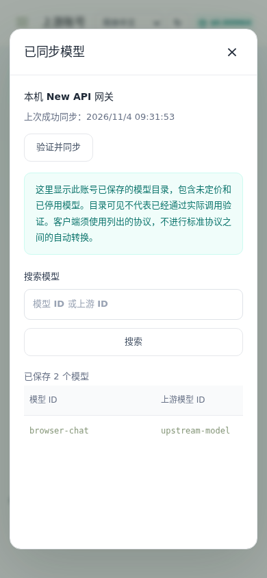

# 上游账号模型目录

管理员进入“上游账号”后，每张账号卡片显示已保存的模型数量和上次成功同步时间；点击“查看模型”可查看该账号自己的目录。验证并同步成功后自动打开结果。

列表支持模型 ID / 上游 ID 搜索、分页、每页 10/20/50/100 项和复制模型 ID。网关别名与原始上游 ID 分开显示；未定价、停用和账号不可路由的模型仍保留可见。列表读取本地快照，不在打开页面时偷偷请求上游或产生推理费用。目录可见和“已配置”均不表示模型已通过实际调用验收。

同步失败保留上一次成功的目录和时间；成功返回空目录则保存空结果。不同账号即使共享同名模型，模型归属和同步时间也相互独立。旧版未记录账号级同步时间，显示“未记录”，重新同步后补齐，避免把其他账号更新同一模型的时间当成此次同步时间。

管理员只读接口：

```text
GET /api/admin/accounts/{id}/models?page=1&page_size=20&search=gpt
```

返回 `account_id/items/total/page/page_size/synced_at`；每条包含 `id/upstream_id/protocol/enabled/priced/routable`。普通用户无法访问此接口，不返回上游凭据。账号列表另提供 `model_count/models_synced_at`。

## 本次 OpenAI 缺失模型的根因

2026-11-02 对同一份已导入授权进行真实对照：

| client_version、version 及默认 UA 的版本 | 上游返回模型数 | gpt-6.1-sol |
| --- | --- | --- |
| 0.146.0 | 5 | 未返回 |
| 0.153.0 | 6 | 未返回 |
| 0.164.0 | 10 | 返回 |
| 本机安装版本 0.164.0-alpha.11.1 | 10 | 返回 |

旧身份直接调用 `gpt-6.1-sol` 返回 HTTP 400 / `model_not_found`；使用 0.164.0 后，同一授权通过目录、JSON 文本、SSE 工具及结果回传、客户端取消和额度核对。这次差异由客户端版本声明造成，不是需要手工配置模型映射，也不是账号没有该模型权限。

现在统一采用本机验证过的默认版本 **0.164.0**。新账号使用新默认；既有官方配置若仍为旧内置 0.146.0 且没有自定义 UA，则在读取和验证时应用新版默认。自定义模型端点、自定义 UA 和其他显式客户端版本保留；目录 query、默认 UA 和 version 头保持一致。Codex manifest 请求的客户端版本也用于该次 version 头，避免 query 与请求头不一致。

版本号不能永久写死而不维护；今后需要把默认身份更新纳入兼容性回归。这个实测版本不代表对所有账号、模型或未来客户端作兼容保证。

## 升级与使用

启动执行迁移 007（schema 7），只新增账号同步时间列，保留已有账号 ID、密文、模型关联和账单。升级前按 [部署说明](deployment.md) 备份数据库及原主密钥；旧程序不能直接打开升级后的 schema，回滚使用升级前备份。

1. 构建并启动新版，保持原数据库和主密钥。
2. 在 OpenAI 账号点击“验证并同步”。如果配置了自定义版本或 UA，先核对其版本声明。
3. 自动打开已同步目录，确认 `gpt-6.1-sol`。
4. 到“模型与价格”核对并配置内部价格。未定价模型仍可查看，但不开放调用；不要把验收用的内部测试价格当作供应商报价。

自定义客户端版本或 UA 时，需保持目录与推理的版本声明一致。无需删除账号或重新 OAuth。



`protocols` 与 `protocol_status`，显示同模型完整协议能力和各协议冷却状态；旧 protocol 字段作为首选/兼容字段保留，不能再用它代表全部能力。协议由上游配置确定，价格独立设置；详见 [多协议说明](model-protocols.md)。
